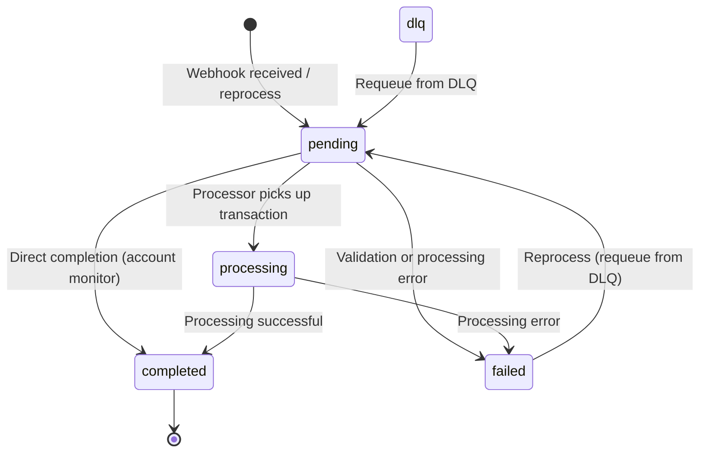

# Transaction State Machine

This document describes the transaction lifecycle and state transitions in Synapse Core.

## State Diagram



## States

### pending
**Initial state** — Transaction created and awaiting processing.

**Entry conditions:**
- Webhook received with valid payload
- Transaction requeued from DLQ (`failed → pending`)
- Transaction requeued from the DLQ table (`dlq → pending`)

**Exit transitions:**
- → `processing`: Processor picks up the transaction
- → `completed`: Direct completion (e.g., account monitor matches payment)
- → `failed`: Validation or processing error

**Database field:** `status = 'pending'`

---

### processing
**Intermediate state** — Transaction is actively being processed.

**Entry conditions:**
- Processor picks up a `pending` transaction

**Exit transitions:**
- → `completed`: Processing pipeline succeeds
- → `failed`: Processing pipeline fails

**Database field:** `status = 'processing'`

---

### completed
**Terminal state** — Transaction successfully processed and verified.

**Entry conditions:**
- Processing pipeline completes successfully
- Account monitor matches an incoming payment to a pending transaction

**Exit transitions:** None (terminal state)

**Database field:** `status = 'completed'`

---

### failed
**Error state** — Transaction failed and may be reprocessed.

**Entry conditions:**
- Processing error occurred at any stage

**Exit transitions:**
- → `pending`: Manual requeue via `requeue_dlq()` API

**Database field:** `status = 'failed'`

---

### dlq
**Dead-letter state** — Transaction parked in the DLQ table after repeated failures.

**Entry conditions:**
- Transaction exhausted its retry budget and was moved to the DLQ

**Exit transitions:**
- → `pending`: Requeue from the DLQ (`dlq → pending`)

**Database field:** `status = 'dlq'`

---

## Transition Validation

All status updates are guarded by `validate_status_transition(from, to) -> Result<(), AppError>` in `src/validation/state_machine.rs`.

Invalid transitions return `AppError::InvalidStatusTransition` (HTTP 400, code `ERR_TRANSACTION_005`).

### Valid Transitions Table

| From        | To          | Trigger                                 |
|-------------|-------------|-----------------------------------------|
| pending     | processing  | Processor picks up transaction          |
| pending     | completed   | Account monitor direct completion       |
| pending     | failed      | Validation or processing error          |
| processing  | completed   | Processing pipeline success             |
| processing  | failed      | Processing pipeline error               |
| failed      | pending     | Admin requeue from DLQ                  |
| dlq         | pending     | Requeue from DLQ                        |

Same-state transitions (`X → X`) are always valid (idempotent) and are not listed above.

### Invalid Transitions (examples)

| From        | To          | Reason                                  |
|-------------|-------------|-----------------------------------------|
| completed   | pending     | Terminal state — cannot be reversed     |
| completed   | processing  | Terminal state — cannot be reversed     |
| completed   | failed      | Terminal state — cannot be reversed     |
| processing  | pending     | Must complete or fail, not revert       |
| failed      | processing  | Must go through pending first           |
| failed      | completed   | Must go through pending first           |
| dlq         | processing  | Must go through pending first           |
| dlq         | completed   | Must go through pending first           |
| dlq         | failed      | Must go through pending first           |

### Settlement Transitions

Settlement transitions are defined by `SETTLEMENT_TRANSITIONS` in `src/validation/state_transitions.rs` and validated with `is_valid_transition()` (see `STATE_MACHINE_DIAGRAMS.md` for the diagram).

| From            | To              | Trigger                     |
|-----------------|-----------------|-----------------------------|
| completed       | pending_review  | Settlement flagged for review |
| pending_review  | disputed        | Review opened a dispute     |
| pending_review  | voided          | Review voided the settlement |
| pending_review  | completed       | Review cancelled            |
| disputed        | adjusted        | Dispute resolved by adjustment |
| disputed        | voided          | Dispute resolved by voiding |
| adjusted        | completed       | Adjustment applied          |

Same-state settlement transitions (`X → X`) are always valid (idempotent).

---

## Code References

### Validation Function
- `src/validation/state_machine.rs` — `validate_status_transition(from, to)`
- `src/validation/state_transitions.rs` — `TRANSACTION_TRANSITIONS`, `SETTLEMENT_TRANSITIONS`, `is_valid_transition(from, to, allowed)`

### Status Update Sites
- `src/services/transaction_processor.rs` — `CompleteStage::execute()` (pending/processing → completed)
- `src/services/transaction_processor.rs` — `requeue_dlq()` (failed → pending, dlq → pending)
- `src/services/account_monitor.rs` — `process_payment()` (pending → completed)

### Database Schema
- `migrations/20250216000000_init.sql` — `status VARCHAR(20) NOT NULL DEFAULT 'pending'`
- `migrations/20260220143500_transaction_dlq.sql` — DLQ table

---

## Error Handling

Invalid transitions return:

```json
{
  "error": "Invalid status transition: Cannot transition from 'completed' to 'pending'",
  "code": "ERR_TRANSACTION_005",
  "status": 400
}
```
